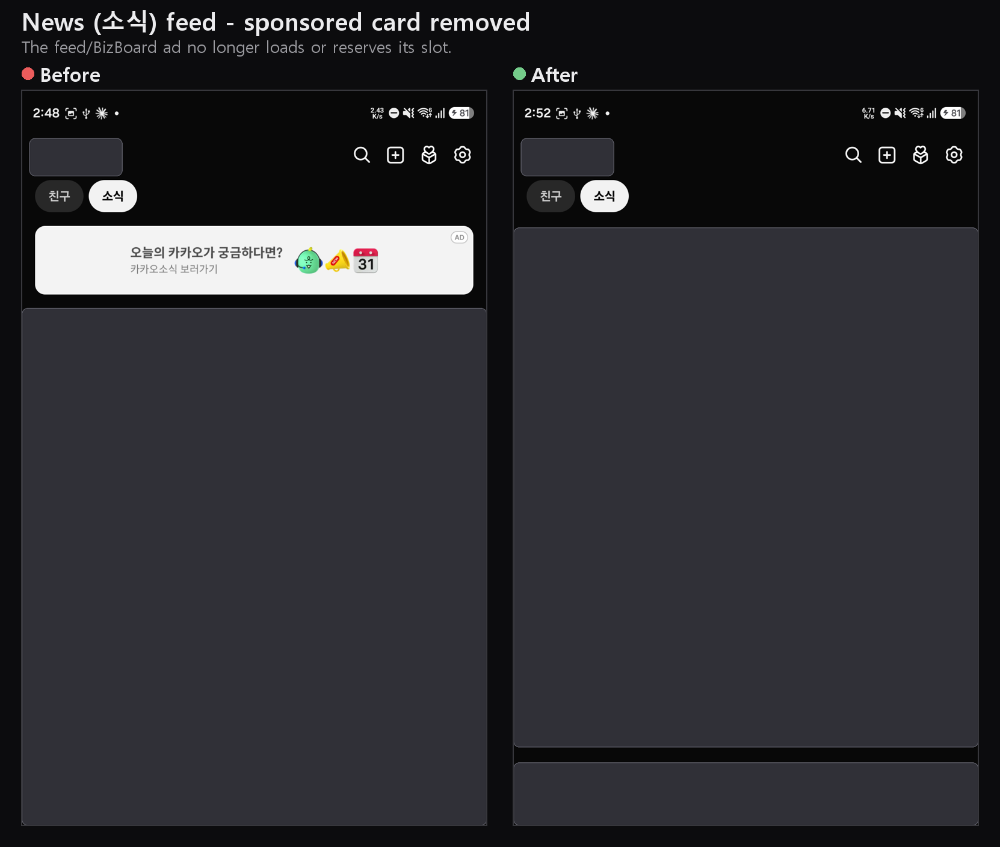
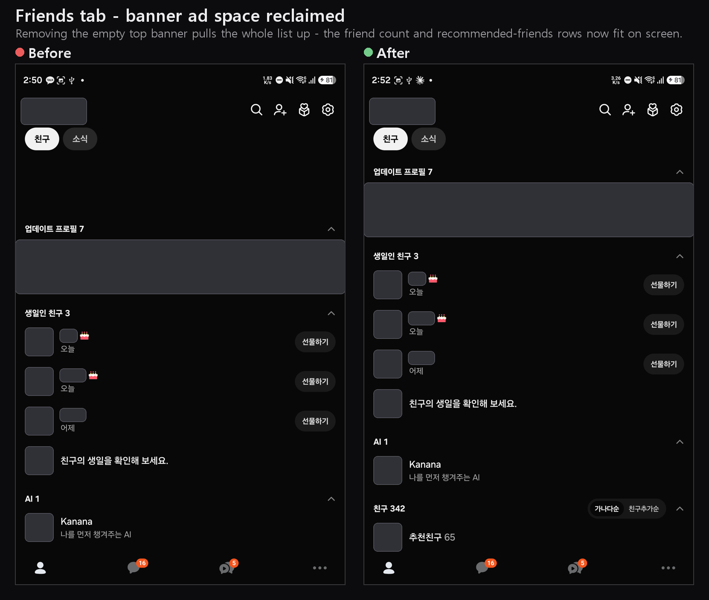

# 🚫 Block KakaoPay + KakaoTalk cleanup

[Morphe](https://morphe.software) patches for KakaoTalk, made to run alongside
[AmpleReVanced](https://github.com/AmpleReVanced/revanced-patches).
카카오톡용 Morphe 패치 묶음이에요. AmpleReVanced와 함께 써요.

**Add to Morphe:** https://morphe.software/add-source?github=wonjoonSeol/morphe-patches

> [!IMPORTANT]
> **KakaoTalk 26.8.3 only.** 26.9.0 is not supported.
> **카카오톡 26.8.3만 지원해요.** 26.9.0은 지원하지 않아요.

> [!CAUTION]
> **A patched KakaoTalk can get your Kakao account banned**
> ([Kakao operation policy](https://www.kakao.com/policy/oppolicy), section 4). Follow the checklist
> below exactly, and apply it carefully at your own risk.
> **패치된 카카오톡은 계정이 정지될 수 있어요**
> ([카카오 운영정책](https://www.kakao.com/policy/oppolicy) 4항). 아래 체크리스트를 그대로 따르고,
> 본인 책임으로 신중하게 적용해주세요.

## 📦 What to install / 설치할 것

| | Version / 버전 | Get it / 받기 |
|---|---|---|
| Morphe Manager | latest | [morphe.software](https://morphe.software) |
| KakaoTalk | **26.8.3** (APKM) | [APKMirror](https://www.apkmirror.com/apk/kakao-corp/kakaotalk/kakaotalk-messenger-26-8-3-release/) |
| This bundle / 이 묶음 | latest | [Add to Morphe](https://morphe.software/add-source?github=wonjoonSeol/morphe-patches) |
| AmpleReVanced | **v1.5.0-dev.19** | [patches-1.5.0-dev.19.mpp](https://github.com/AmpleReVanced/revanced-patches/releases/download/v1.5.0-dev.19/patches-1.5.0-dev.19.mpp), add as a **Local** source / **로컬** 소스로 추가 |

- Don't use AmpleReVanced's **Pre-release patches** toggle: v1.5.0-dev.22 targets 26.9.0.
- AmpleReVanced **Pre-release 패치** 토글은 쓰지 마세요. v1.5.0-dev.22는 26.9.0 대상이에요.

## ✅ Patches to enable / 켤 패치

Morphe Manager: **Expert mode** on > select KakaoTalk > **Disable all** > enable only these.
Morphe Manager: **전문가 모드** 켜기 > 카카오톡 선택 > **모두 비활성화** > 아래 패치만 켜기.

**This bundle / 이 묶음 (4)**
- `Block KakaoPay`, `Disable Friend Feed ads`, `Hide Friends tab banner ad`, `Set collapsed OpenChat room count`

**AmpleReVanced (40)**
- Settings / 설정: `Add settings resources`, `Add settings tab`
- Short-form and ads / 숏폼, 광고: `Remove Short-form Tab`, `Disable ShortForm ad`, `Disable ChatRoomAdController`, `Disable Friend Lists ad`, `Disable OpenChat feed ad`, `Disable Pay banner ad`, `Disable chat room list ad`, `Remove BizBoard ads`, `Remove More tab ad`, `Remove OpenLink chat room list ad`, `Remove feed ad`, `Remove focus ad`, `Remove native ad`
- Integrity / 무결성 (keep all / 모두 필수): `Disable verifying signature`, `Spoof signature`, `Hook Package Manager`, `Spoof apk checksums`, `Spoof App ID`, `Spoof installer package name`, `Spoof attestation package name`, `Disable abuse detection report`, `Disable AdFit environment detection`
- KakaoPay / 카카오페이: `Bypass Moat check`, `Remove shop tab`, `Hide More tab components`
- Privacy / 개인정보: `Disable S2Event`, `Disable SDK Tracker`, `Disable Sentry`, `Strip image metadata`, `Default external browser`
- Chat / 채팅: `Show deleted, hidden, or edited messages`, `Block reactions on deleted or hidden messages`, `Block replies on deleted or hidden messages`, `Show message read receipts`, `Show messages restricted to mobile`
- Convenience / 편의: `Allow profile media download`, `Open profile from open chat feed`, `Ghost Mode`

**Never enable / 절대 켜지 마세요**

| Patch | Why / 이유 |
|---|---|
| `Force enable emoticon plus feature` (on by default) | Sends paid emoticons you didn't buy / 구매하지 않은 유료 이모티콘 전송 |
| `Override feature flag` (on by default) | Turns on features Kakao hasn't enabled for you / 카카오가 켜지 않은 기능을 켬 |
| `Change package name` | Installs as `com.kakao.talk.revanced` / 다른 패키지 이름으로 설치 |
| `Add Packet Handler` | Lets other apps handle KakaoTalk's packets / 다른 앱이 카카오톡 패킷을 다룸 |

## ⚙️ After installing / 설치 후

In KakaoTalk's Morphe settings, turn on / 카카오톡 안의 Morphe 설정에서 켜기:
- **Advanced > Bypass Moat integrity detection** / **고급 > Moat 무결성 감지 우회**
- **Hide KakaoPay section** / **카카오페이 섹션 숨기기**

## 🛡️ Checklist / 체크리스트

- [ ] Versions match the table above / 위 표와 버전이 정확히 같음
- [ ] Started from **Disable all** (AmpleReVanced turns on 71 of its 75 patches by default) / **모두 비활성화**에서 시작 (AmpleReVanced는 75개 중 71개가 기본 켜짐)
- [ ] No patch failed. If `Disable verifying signature`, `Spoof signature`, `Disable abuse detection report` or `Block KakaoPay` failed, don't install / 실패한 패치 없음. 이 네 개 중 하나라도 실패하면 설치 금지
- [ ] Opening KakaoPay closes it at once / 카카오페이를 열면 바로 닫힘
- [ ] Never pay with the patched app / 패치된 앱으로 결제 금지

Even then the risk remains: a re-signed build can never pass Play Integrity. Apply it carefully at
your own risk.
그래도 위험은 남아요. 재서명된 빌드는 Play Integrity를 절대 통과할 수 없어요. 본인 책임으로 신중하게
적용해주세요.

## 💻 Morphe Desktop

```sh
java -jar morphe-desktop-<version>-all.jar patch --exclusive \
  -p patches-1.5.0-dev.19.mpp -e "Add settings resources" -e "Add settings tab" ... \
  -p patches-1.1.0.mpp -O collapsedCount=4 -e "Block KakaoPay" ... \
  -r result.json -o kakaotalk-patched.apk <KakaoTalk-26.8.3.apkm>
```

One `-e` per patch above. `failedPatches` in `result.json` must be empty.

## 🧩 This bundle / 이 묶음

### Block KakaoPay

Closes every KakaoPay screen the moment it opens (including money-transfer and gift links), so the
KakaoPay integrity scan (Moat) never runs on the re-signed app. Pay with the original app.
카카오페이 화면을 열리자마자 닫아서(송금/선물 링크 포함) 재서명된 앱에서 Moat 무결성 검사가
실행되지 않게 해요. 결제는 원본 앱으로 하세요.

### Disable Friend Feed ads

Stops the Friends tab news feed (소식) from loading its sponsored and BizBoard ads, and removes the
empty placeholder card.
친구 탭 소식 피드의 스폰서/BizBoard 광고를 막고, 빈 자리 카드도 없애요.



### Hide Friends tab banner ad

Collapses the empty BizBoard banner slot at the top of the Friends tab.
친구 탭 맨 위의 빈 BizBoard 배너 자리를 접어요.



### Set collapsed OpenChat room count

OpenChat rooms shown before the more button: KakaoTalk shows 3, this patch defaults to 4. Change it
with the `collapsedCount` option (1 to 50).
더보기 전에 보이는 오픈채팅 방 개수예요. 기본 3개, 이 패치는 4개이고 `collapsedCount` 옵션(1~50)으로
바꿀 수 있어요.

---

## 🩹 Patches list

<!-- PATCHES_START EXPANDED -->
> **[v1.1.0](https://github.com/wonjoonSeol/morphe-patches/releases/tag/v1.1.0)**&nbsp;&nbsp;•&nbsp;&nbsp;`main`&nbsp;&nbsp;•&nbsp;&nbsp;4 patches total
<details open>
<summary>📦 Kakao Talk&nbsp;&nbsp;•&nbsp;&nbsp;4 patches</summary>
<br>

**🎯 Supported versions:**

| 26.8.3 |
| :---: |

| 💊&nbsp;Patch | 📜&nbsp;Description | ⚙️&nbsp;Options |
|----------|----------------|-----------|
| [Block KakaoPay](#block-kakaopay) | Closes every KakaoPay screen the moment it opens and stops the KakaoPay Moat scan from running on this re-signed client. Pay on the original, unpatched app instead. |  |
| [Disable Friend Feed ads](#disable-friend-feed-ads) | Stops the Friends tab news feed from loading its sponsored feed ad and its BizBoard native ad, and removes the empty BizBoard placeholder card so no blank slot is left behind, which other KakaoTalk ad patch sources leave in place. |  |
| [Hide Friends tab banner ad](#hide-friends-tab-banner-ad) | Collapses the empty BizBoard banner slot at the top of the Friends tab so it leaves no blank space, which other KakaoTalk ad patch sources leave reserved. |  |
| [Set collapsed OpenChat room count](#set-collapsed-openchat-room-count) | Sets how many OpenChat rooms show in the collapsed list before the more button (KakaoTalk default is 3). Change it with the collapsedCount option at patch time. | • Collapsed OpenChat room count |

</details>

<!-- PATCHES_END -->

## 🛠️ Building

Building resolves the Morphe patcher from the Morphe GitHub Packages registry, which requires
authentication even for public packages. Create a GitHub token with the `read:packages` scope and
add it to `~/.gradle/gradle.properties` (your user home, never committed):

```properties
gpr.user=your-github-username
gpr.key=your-token-with-read-packages
```

Then:

- Run `./gradlew buildAndroid`
- The built `.mpp` is in `patches/build/libs/patches-*.mpp`; apply it with
  [Morphe Desktop](https://github.com/MorpheApp/morphe-desktop) like any other patch bundle.

## ⚠️ Disclaimer

For personal and research use. Not affiliated with or endorsed by Kakao. A modified client may
violate KakaoTalk's terms of service and can get your account banned.

## 📜 License

Licensed under the [GNU General Public License v3.0](LICENSE).
